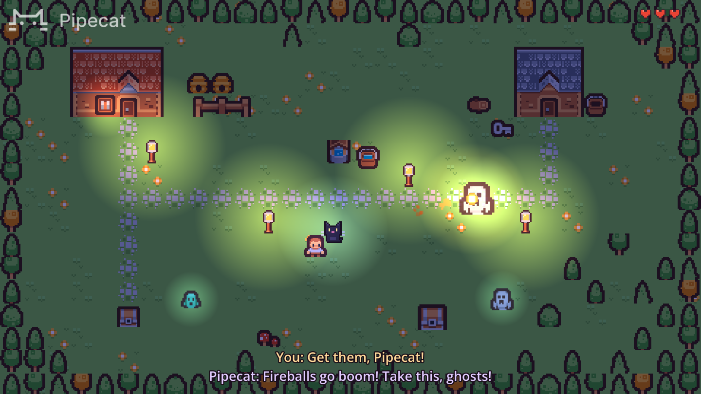

<h1><div align="center">
 
</div></h1>

[](https://docs.pipecat.ai) [](https://discord.gg/pipecat)

# Pipecat Godot Demo

This demo shows how to bring a [Pipecat](https://github.com/pipecat-ai/pipecat)
voice agent into a [Godot](https://godotengine.org) game. Talk to Pipecat, a
little black cat with magic powers, and it does what you ask around the village.

It's dusk in a small village, and Pipecat walks around you. Ask it to light
the lamps, to bring you a key, or to open a chest with it, and it goes off to
do it, and tells you how it went. Now and then, ghosts show up, and Pipecat
panics: tell it to fight them, and it throws fireballs at them until they're
gone. It only does what you tell it to. Or find the sword, and fight them
yourself. It all comes with a spooky waltz, and sounds for fireballs, ghosts,
chests and the rest.

The cat is a Pipecat bot, a voice agent that hears you with Deepgram, answers
with OpenAI and speaks with Cartesia. The game talks to it over a WebSocket
with the [Pipecat C++ client](https://github.com/pipecat-ai/pipecat-client-cxx),
through a GDExtension that GDScript uses like any other node. The bot has two
LLMs: one talks with you, and hands what you ask for to the other, which does it
in the game, step by step. The game owns the village: it does each action, and
answers with how it went.

<p align="center">
 
</p>

## 📋 Requirements

- Linux, on x86_64 or arm64. The Pipecat C++ client also supports macOS and
  Windows, but the GDExtension isn't set up for them yet.
- [Godot](https://godotengine.org/download) 4.7.
- CMake, Ninja, Git and a C++17 compiler, to build the GDExtension, and the
  development files of libcurl and OpenSSL, which the Pipecat C++ client uses.
  On Debian and Ubuntu:
  ```
  sudo apt-get install cmake ninja-build g++ git libcurl4-openssl-dev libssl-dev
  ```
- [uv](https://docs.astral.sh/uv/), to run the bot.
- API keys for [Deepgram](https://console.deepgram.com),
  [OpenAI](https://platform.openai.com/api-keys) and
  [Cartesia](https://play.cartesia.ai/keys), for the bot.
- A microphone. Headphones work best: the game doesn't cancel Pipecat's echo,
  so with speakers Pipecat can hear itself.

## 🔨 Build

Get the demo, and build the Pipecat GDExtension:

```
git clone https://github.com/pipecat-ai/pipecat-godot-demo
cd pipecat-godot-demo
cmake -S addons/pipecat -B build -G Ninja -DCMAKE_BUILD_TYPE=Release
cmake --build build
```

This downloads [godot-cpp](https://github.com/godotengine/godot-cpp) and the
Pipecat C++ client, with its WebSocket transport, and builds the GDExtension
into `addons/pipecat/bin`. To build it with your own copy of the Pipecat C++
client, add `-DFETCHCONTENT_SOURCE_DIR_PIPECAT=/path/to/pipecat-client-cxx` to
the first `cmake`.

Build it before opening the project in Godot, which loads the GDExtension as it
opens the project.

## 🚀 Run

1. Start the bot, with your API keys in `pipecat/.env`:

   ```
   cd pipecat
   cp env.example .env  # Then set the API keys in it.
   uv run bot.py -t websocket
   ```

   It waits for the game at `http://localhost:7860`.

2. In another terminal, from this directory, run the game:

   ```
   godot --path .
   ```

   Or open the project in the Godot editor, with `godot -e --path .` or from
   the Project Manager, and press Play (F5).

The game opens on its main screen. Choose Play, and Pipecat connects to the
bot, greets you, and listens. Walk around with the
arrow keys or WASD, and talk to it, e.g.:

- "Could you light the lamps?"
- "Bring me the sword." Pipecat doesn't know where it is, so it asks you.
- "Try any of the chests."
- "Bring me the iron key."
- "Now try the other chest."
- When ghosts show up: "Get them, Pipecat!"
- "Go to the well." And then: "Come back!"

Each takes a few seconds, as Pipecat walks around. Pipecat doesn't know what's
in the chests, or which key opens which, until it tries, and it only does what
you ask: when it's stuck, it asks you what to do. The key and the chests are
somewhere new every game, far from each other. Its fireballs only reach
so far, so it waits for ghosts far away to get closer. You can also do it all
yourself: walk over things to pick them up, and walk up to a chest to open it,
if you have its key. Once you have the sword, you hold it, and swing it with
Space. If a ghost reaches you, it scares you, and you lose half of one of your
three hearts. Lose them all, and you faint, and wake up at home.

| Key                | What it does                                              |
| ------------------ | --------------------------------------------------------- |
| Arrow keys or WASD | Walk, and pick up what you walk over                      |
| Space              | Swing the sword, once you have it                         |
| F or F11           | Fullscreen, and back                                      |
| Esc                | Back to the main screen                                   |
| Arrow keys and Enter, or the mouse | Choose Play or Exit Game, on the main screen |

These are the actions Pipecat can do, with `do_action`:

| Action         | What Pipecat does                                                |
| -------------- | ---------------------------------------------------------------- |
| `go_to`        | Walks to the house, the shed, the well, a chest or the woods, and stays there |
| `pick_up`      | Picks up the iron key, the bucket, the mushroom, or what's in the chests |
| `give`         | Gives you what it carries                                        |
| `open_chest`   | Tries to open a chest with the key it carries, or one it takes from you |
| `light_lamps`  | Lights the lamps, one by one                                     |
| `follow`       | Comes back, and follows you around                               |

It also has `fight_ghosts`, to throw fireballs at the ghosts around until
they're gone, and `look_around`, to find out what's in the village now.

## ⚙️ How it works

- The Pipecat GDExtension, in `addons/pipecat`, adds a `PipecatClient` node. It
  starts the bot and talks to it with the Pipecat C++ client: it sends the bot
  the microphone, plays the bot's voice, and emits signals as things happen,
  like `bot_output` when the bot says something.
- The bot, in `pipecat/bot.py`, has two LLMs, joined by Pipecat's
  `LLMWithBackend`. The one you talk to only talks, so it answers right away.
  What you ask Pipecat to do, it hands to the game worker, a `BackendLLMWorker`
  with an LLM of its own and Pipecat's functions, and says it's on it.
- The game worker does what you asked, step by step, e.g. picking up the key,
  and then giving it to you. Each step goes to the game as a server message.
  The game does it, e.g. walking Pipecat over to the key, and answers with a
  client message saying how it went. Once it's all done, the game worker says
  how it went, and Pipecat tells you.
- Pipecat does one thing at a time, and fights alongside. The game worker
  takes new requests while it works, so you can ask for something else while
  Pipecat fights.
- Pipecat only does what you ask: the bot only hands something over to the game
  worker if you've spoken since the last thing that happened in the game, so
  Pipecat doesn't decide to fight ghosts on its own.
- The game, in `village/village.gd`, owns the village. When the bot is ready,
  the game tells the game worker what's in the village, and sends it what's in
  it now whenever that changes, so it can look around right away. It tells the
  bot when something happens that Pipecat reacts to, e.g. when ghosts show up,
  so Pipecat stops what it's saying, and warns you.
- Pipecat glows as it speaks, you glow as you speak, and subtitles show what
  you both say, until you've had time to read them.

In GDScript, an action looks like this:

```gdscript
@onready var pipecat: PipecatClient = $PipecatClient

func _ready() -> void:
	pipecat.server_message.connect(_on_server_message)

func _on_server_message(data: Variant) -> void:
	if data["type"] == "do_action" and data["action"] == "go_to":
		var place: String = data["what"]
		await cat.walk_to(places[place].position)  # Takes a few seconds.
		var result := "You're at the %s." % place
		pipecat.send_client_message("action_done", {"id": data["id"], "result": result})
```

## 🧩 The Pipecat node

To use `PipecatClient` in your own project, copy `addons/pipecat` into it, and
build it there, as above. To use the microphone, turn on Audio > Driver >
Enable Input in the project settings.

It has these properties:

- `start_url`: the bot's start endpoint, `http://localhost:7860/start` by
  default.
- `api_key`: sent as a bearer token to the start endpoint, e.g. a Pipecat Cloud
  public API key.
- `connect_on_ready`: starts the bot and connects once the scene is ready. On
  by default.
- `use_microphone`: sends the microphone to the bot. On by default.

These methods:

- `connect_to_bot()` and `disconnect_from_bot()`.
- `is_bot_ready()`.
- `send_text(text)`: sends text to the bot, as if the user said it.
- `send_client_message(type, data)`: sends the bot a message of your own.
- `get_bot_voice_level()` and `get_microphone_level()`: how loud the bot and
  the user are, from 0 to 1.

And these signals, on the main thread:

- `bot_ready`, `disconnected` and `error(message)`.
- `user_started_speaking`, `user_stopped_speaking` and
  `user_transcript(text, final)`.
- `bot_started_speaking`, `bot_stopped_speaking`, `bot_interrupted` and
  `bot_output(text)`.
- `server_message(data)`: a message from the bot.
- `function_call(function_call)`: the bot's LLM called a function. Run it, and
  answer with `function_call.respond(result)`, right away or later.

## 🎛️ Options

The game takes these after `--`, e.g.
`godot --path . -- --no-microphone --say "Light the lamps"`:

- `--start-url URL`: the bot's start endpoint. It's
  `http://localhost:7860/start` by default.
- `--api-key KEY`, or the `PIPECAT_API_KEY` environment variable: an API key
  for starting the bot, e.g. a Pipecat Cloud public API key.
- `--no-microphone`: doesn't use the microphone.
- `--say "..."`: sends the bot a message once it's ready, e.g. to try it
  without talking.

## 🗂️ What's where

- `addons/pipecat`: the Pipecat GDExtension, with `PipecatClient` and
  `PipecatFunctionCall` in `src`, and the `CMakeLists.txt` that builds it.
- `title`: the main screen.
- `game.gd`: what the game does on every screen: it sizes the window, goes
  fullscreen, and plays the music, which carries on from screen to screen.
- `village`: the demo: the village, Pipecat, the player, the ghosts and the
  fireballs, the lamps and the chests.
- `assets`: the tiles and characters, from Kenney's
  [Tiny Town](https://kenney.nl/assets/tiny-town) and
  [Tiny Dungeon](https://kenney.nl/assets/tiny-dungeon), and the demo's own:
  Pipecat, the fireball, the hearts, the lamp and the logo, and in `sounds`,
  the music and the sound effects, all synthesized.
- `pipecat`: the bot.

## 📄 License

The demo is licensed under the [BSD 2-Clause License](LICENSE). Kenney's tiles
and characters are [CC0](assets/kenney/License.txt).
